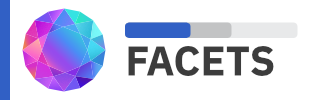

<div align="center">



</div>

# Facet Plug-ins
---  

This document outlines how to use and add a facet plug-in into your application. The [facet-plugins library](https://www.npmjs.com/package/@uncharted.software/facets-plugins) ships with two predefined plug-ins `facet-plugin-zoom-bar` and `facet-plugin-scrollbar`.

## Using a Facets Plug-in
To use a facet plug-in you simply need to include it as a child of a facet and specify which slot (`header`, `footer`, `left`, `right` or `content`) the plug-in is inserted into.

For example, this shows inserting the `facet-plugin-zoom-bar` plug-in into a `facet-bars` facet. (This can be seen in action at [https://unchartedsoftware.github.io/facets/?ex=facet-bars](https://unchartedsoftware.github.io/facets/?ex=facet-bars).)

```html
<facet-bars id="facet05" domain="[0, 100]" view="[38, 48]" data='{
    "label": "... Stacked Labels + Domain",
    "values": {
        "20": { "ratio": 0.1, "label": ["JAN", "Q1"] },
        ...,
        "55": { "ratio": 0.2, "label": ["DEC", "Q4"] }
    }
}'>
    <facet-plugin-zoom-bar slot="footer"></facet-plugin-zoom-bar>
</facet-bars>
```
## Writing a Facet Plug-in
The simplest way to demonstrate writing a plug-in is to show the code for an existing one.

```typescript
// Facets are based on the lit library. Import the necessary lit functions and decorators.
import {css, CSSResult, unsafeCSS, html, TemplateResult} from 'lit';
import { customElement } from 'lit/decorators.js';

// Import the Facet classes necessary for the plugin.
import {FacetPlugin, FacetBarsBase} from '@uncharted.software/facets-core';

// @ts-ignore - depending on your build environment TypeScript might complain about importing a CSS file.
import ZoomBarStyle from './ZoomBar.css';

// Use the lit customElement decorator to declare the web component.
@customElement('facet-plugin-zoom-bar')
// Derive the plug-in from the FacetPlugin class. This ensures it is properly wired up to the facets environment.
export class ZoomBar extends FacetPlugin {
    // Make the styles for the plug-in available.
    public static get styles(): CSSResult[] {
        return [
            css`${unsafeCSS(ZoomBarStyle)}`
        ];
    }

    // Get a description of the properties supported by this plug-in.
    public static get properties(): any {
        return {
            enabled: { type: Object }
        };
    }

    // Define and implement the properties used by this plug-in.
    private _enabled: boolean = true;
    public get enabled(): boolean {
        return true;
    }
    public set enabled(value: boolean) {
        const oldValue = this._enabled;
        this._enabled = value;
        if (!this._enabled) {
            this.mouseTarget = null;
        }
        this.requestUpdate('enabled', oldValue);
    }

    // facet is containing facet of the plug-in.
    private facet: FacetBarsBase | null = null;

    // Define any necessary instance variables.
    private mouseTarget: string | null = null;
    private mouseX: number | null = null;
    private boundMouseHandler: EventListener = this.handleMouseEvent.bind(this);

    // hostChanged is defined by FacetPlugin. It is called by the facets framework when a plug-in is connected to the DOM.
    protected hostChanged(host: HTMLElement|null): void {
        if (this.facet) {
            // Clean up listeners on any previous parent facet.
            this.facet.removeEventListener('mousemove', this.boundMouseHandler);
            this.facet.removeEventListener('mouseleave', this.boundMouseHandler);
            this.facet.removeEventListener('mouseup', this.boundMouseHandler);
            this.facet.removeEventListener('touchstart', this.boundMouseHandler);
            this.facet.removeEventListener('touchend', this.boundMouseHandler);
            this.facet.removeEventListener('touchcancel', this.boundMouseHandler);
            this.facet.removeEventListener('touchmove', this.boundMouseHandler);
        }

        if (host instanceof FacetBarsBase) {
            // Connect the plug-in to it's parent. This plug-in assumes the parent facet is an instance of a FacetBarsBase
            // class which includes the FacetBars and FacetTerms facets.
            this.facet = host;
            this.facet.addEventListener('mousemove', this.boundMouseHandler);
            this.facet.addEventListener('mouseleave', this.boundMouseHandler);
            this.facet.addEventListener('mouseup', this.boundMouseHandler);
            this.facet.addEventListener('touchstart', this.boundMouseHandler);
            this.facet.addEventListener('touchend', this.boundMouseHandler);
            this.facet.addEventListener('touchcancel', this.boundMouseHandler);
            this.facet.addEventListener('touchmove', this.boundMouseHandler);
        } else {
            this.facet = null;
        }
    }

    // This is called by the facets framework when a property of the parent facet has changed.
    protected hostUpdated(changedProperties: Map<PropertyKey, unknown>): void {
        super.hostUpdated(changedProperties);
        if (changedProperties.has('view') || changedProperties.has('domain') || changedProperties.has('selection')) {
            // requestUpdate() exists on the FacetPlugin class and causes a lifecycle update that may include a rerendering
            // of the plug-in.
            this.requestUpdate();
        }
    }

    // The render() method is called by the facets framework when the plug-in needs to be rendered. It must return
    // a TemplateResult which generally means it must use lit's html tagged strings.
    protected render(): TemplateResult | void {
        if (this.facet) {
            const domain = this.facet.domain;
            const view = this.facet.view;
            const selection = this.facet.selection;
            const domainLength = domain[1] - domain[0];
            const thumbLeft = (((view[0] - domain[0]) / domainLength) * 100).toFixed(2);
            const thumbRight = ((1.0 - (view[1] - domain[0]) / domainLength) * 100).toFixed(2);
            const selectionLeft = selection ? (((selection[0] - domain[0]) / domainLength) * 100).toFixed(2) : 0;
            const selectionRight = selection ? ((1.0 - (selection[1] - domain[0]) / domainLength) * 100).toFixed(2) : 100;
            return html`
            <div class="zoom-bar-container">
                <div class="zoom-bar-background">
                    <div class="zoom-bar-area">
                        <div class="zoom-bar-selection" style="left:${selectionLeft}%;right:${selectionRight}%;"></div>
                        <div class="zoom-bar-thumb" @mousedown="${this.handleMouseEvent}" style="left:${thumbLeft}%;right:${thumbRight}%;display:${this._enabled ? 'block' : 'none'}">
                            <div class="zoom-bar-handle zoom-bar-handle-left" @mousedown="${this.handleMouseEvent}"></div>
                            <div class="zoom-bar-handle zoom-bar-handle-right" @mousedown="${this.handleMouseEvent}"></div>
                        </div>
                    </div>
                </div>
            </div>
            `;
        }
        // If the plug-in has no parent facet, do not render anything.
        return html`${undefined}`;
    }

    // If the plug-in has registered (in hostChanged()) to receive events then they should be handled here.
    // The code below is specific to the zoom-bar plug-in. Plug-ins should implement their own solutions.
    private handleMouseEvent(event: Event): void {
        if (this.facet) {
            const mouseEvent = event as MouseEvent;
            const domain = this.facet.domain;
            const domainLength = domain[1] - domain[0];
            switch (mouseEvent.type) {
                case 'mousedown':
                case 'touchstart':
                    if (mouseEvent.currentTarget instanceof Element) {
                        if (mouseEvent.currentTarget.className.indexOf('zoom-bar-thumb') !== -1) {
                            this.mouseTarget = 'thumb';
                            event.preventDefault();
                        } else if (mouseEvent.currentTarget.className.indexOf('zoom-bar-handle-left') !== -1) {
                            this.mouseTarget = 'left-handle';
                            event.stopPropagation();
                            event.preventDefault();
                        } else if (mouseEvent.currentTarget.className.indexOf('zoom-bar-handle-right') !== -1) {
                            this.mouseTarget = 'right-handle';
                            event.stopPropagation();
                            event.preventDefault();
                        } else {
                            this.mouseTarget = null;
                        }
                        this.mouseX = mouseEvent.pageX;
                    }
                    break;

                case 'mouseup':
                case 'mouseleave':
                case 'touchcancel':
                case 'touchend':
                    this.mouseTarget = null;
                    break;

                case 'touchmove':
                case 'mousemove':
                    if (this.mouseTarget) {
                        const zoomBarArea = this.renderRoot.querySelector('.zoom-bar-area');
                        if (zoomBarArea) {
                            const rangeStep = zoomBarArea.scrollWidth / (domainLength + 1);
                            if (this.mouseX !== null) {
                                event.preventDefault();

                                const view = this.facet.view;
                                let distance = Math.round((mouseEvent.pageX - this.mouseX) / rangeStep);
                                if (distance > 0) {
                                    if (this.mouseTarget === 'left-handle') {
                                        distance = Math.min(distance, view[1] - view[0] - 1);
                                    } else {
                                        distance = Math.min(distance, domain[1] - view[1]);
                                    }
                                } else if (distance < 0) {
                                    if (this.mouseTarget === 'right-handle') {
                                        distance = Math.max(distance, view[0] - view[1] + 1);
                                    } else {
                                        distance = Math.max(distance, domain[0] - view[0]);
                                    }
                                }

                                if (distance) {
                                    switch (this.mouseTarget) {
                                        case 'thumb':
                                            this.facet.view = [view[0] + distance, view[1] + distance];
                                            break;

                                        case 'left-handle':
                                            this.facet.view = [view[0] + distance, view[1]];
                                            break;

                                        case 'right-handle':
                                            this.facet.view = [view[0], view[1] + distance];
                                            break;

                                        default:
                                            break;
                                    }

                                    this.mouseX += distance * rangeStep;
                                    this.requestUpdate();
                                }
                            }
                        }
                    }
                    break;

                default:
                    break;
            }
        }
    }
}
```
